# Sơ đồ Lớp UML Tổng thể & Giải thích Thuộc tính / Mối Quan hệ (Tiêu chí 2, 5, 6 — Barem [S2])

> Tài liệu này đồng bộ **100%** với mã nguồn thực tế của dự án **Minecraft Voxel Survival & Creative (Unity 6 C#)** phiên bản `v1.0.0`.
> - Đáp ứng **Tiêu chí 2**: Giải thích chi tiết ý nghĩa từng thuộc tính của **22 lớp thực thể/giá trị trong tầng Domain** (vượt xa yêu cầu tối thiểu $\ge 15$ lớp thực thể của barem).
> - Đáp ứng **Tiêu chí 5**: Sơ đồ lớp UML tổng thể chứa **35 lớp/interface/struct thực tế trong code** (vượt xa mức tối thiểu $\ge 16$ lớp của barem).
> - Đáp ứng **Tiêu chí 6**: Thể hiện đầy đủ cả **5 loại mối quan hệ OOP** (Kế thừa, Thực thi, Hợp thành, Kết tập, Phụ thuộc) cả trong nội bộ từng phân hệ và **giữa 2 phân hệ World (A) & Survival (B)**.

---

## 1. Sơ đồ Lớp UML Tổng thể (Mermaid Class Diagram — 35 Lớp/Interface/Struct)

```mermaid
classDiagram
    direction TB

    %% =========================================================
    %% HỢP ĐỒNG GIAO TIẾP CHUNG (CONTRACTS - TIÊU CHÍ 16)
    %% =========================================================
    class IWorldReader {
        <<interface>>
        +int MaxHeight
        +event Action~BlockChangedEventArgs~ BlockChanged
        +IsInBounds(BlockPos position) bool
        +GetBlock(BlockPos position) BlockId
    }

    class IWorldWriter {
        <<interface>>
        +SetBlock(BlockPos position, BlockId blockId) bool
    }

    class ITerrainGenerator {
        <<interface>>
        +GetBlockAt(BlockPos worldPosition, int seed) BlockId
    }

    class IGameMode {
        <<interface>>
        +string ModeName
        +bool CanFly
        +bool IsInstantBreak
        +bool CanTakeDamage
        +bool ConsumesItemsOnPlace
        +CanBreakBlock(BlockId blockId) bool
    }

    class IWorldRepository {
        <<interface>>
        +Save(string filePath, WorldSaveDto saveData) bool
        +Load(string filePath, out WorldSaveDto saveData) bool
    }

    class ITextureAtlasProvider {
        <<interface>>
        +string ProviderName
        +GetAvailablePacks() IReadOnlyList~string~
        +LoadPack(string packId) ResourcePackManifest
    }

    class IMobFactory {
        <<interface>>
        +CreateMob(MobType type, Vector3 spawnPosition) Mob
    }

    %% =========================================================
    %% PHÂN HỆ A: WORLD, BLOCKS & INFRASTRUCTURE (THÀNH VIÊN A)
    %% =========================================================
    class BlockPos {
        <<struct>>
        +int X
        +int Y
        +int Z
        +Offset(int dx, int dy, int dz) BlockPos
        +ToChunkCoord(int chunkSize) ChunkCoord
        +ToLocalPos(int chunkSize) BlockPos
    }

    class ChunkCoord {
        <<struct>>
        +int X
        +int Z
    }

    class BlockType {
        +BlockId Id
        +string Name
        +bool IsSolid
        +bool IsTransparent
        +float Hardness
        +ItemId DropItemId
        +GetTextureIndex(BlockFace face) int
    }

    class BlockRegistry {
        -Dictionary~BlockId, BlockType~ _definitions
        +Register(BlockType blockType) void
        +Get(BlockId id) BlockType
        +TryGet(BlockId id, out BlockType blockType) bool
        +CreateDefault()$ BlockRegistry
    }

    class Chunk {
        +int Width$
        +int Height$
        +int Depth$
        -BlockId[] _blocks
        +ChunkCoord Coord
        +bool IsDirty
        +GetBlock(int localX, int localY, int localZ) BlockId
        +SetBlock(int localX, int localY, int localZ, BlockId id) void
        +MarkClean() void
    }

    class World {
        -Dictionary~ChunkCoord, Chunk~ _chunks
        -ITerrainGenerator _terrainGenerator
        -int _seed
        -int _maxHeight
        +int Seed
        +int MaxHeight
        +GenerateChunk(ChunkCoord coord) Chunk
        +UnloadChunk(ChunkCoord coord) bool
        +GetBlock(BlockPos position) BlockId
        +SetBlock(BlockPos position, BlockId blockId) bool
    }

    class PerlinTerrainGenerator {
        -int _minHeight
        -int _maxHeight
        -float _scale
        +GetBlockAt(BlockPos worldPosition, int seed) BlockId
    }

    class FlatTerrainGenerator {
        -int _surfaceHeight
        +GetBlockAt(BlockPos worldPosition, int seed) BlockId
    }

    class ChunkMeshBuilder {
        -IWorldReader _worldReader
        -BlockRegistry _blockRegistry
        -int _atlasGridSize
        +BuildMesh(Chunk chunk) ChunkMeshData
    }

    class VoxelRaycaster {
        -IWorldReader _worldReader
        -BlockRegistry _blockRegistry
        +Raycast(Vector3 origin, Vector3 direction, float maxDistance) VoxelRaycastHit
    }

    class ResourcePackManifest {
        +string PackId
        +string DisplayName
        +string Description
        +int PackFormat
        +int TileResolution
        +IReadOnlyDictionary~BlockId, string~ BlockTexturePaths
        +TryGetTexturePath(BlockId blockId, out string path) bool
    }

    class JsonWorldRepository {
        +Save(string filePath, WorldSaveDto saveData) bool
        +Load(string filePath, out WorldSaveDto saveData) bool
    }

    class FolderResourcePackProvider {
        -string _resourcePacksRootPath
        -ITextureAtlasProvider _fallbackProvider
        +GetAvailablePacks() IReadOnlyList~string~
        +LoadPack(string packId) ResourcePackManifest
    }

    class BlockInteractionService {
        -IWorldReader _worldReader
        -IWorldWriter _worldWriter
        -BlockRegistry _blockRegistry
        -ItemRegistry _itemRegistry
        +TryBreakBlock(BlockPos targetPos, Inventory inventory, IGameMode gameMode) bool
        +TryPlaceBlock(BlockPos targetPos, BlockPos footPos, BlockPos headPos, Inventory inv, IGameMode mode) bool
        +CalculateBreakDuration(BlockId blockId, Item heldItem, IGameMode gameMode) float
    }

    %% =========================================================
    %% PHÂN HỆ B: SURVIVAL, ENTITIES, ITEMS & CRAFTING (THÀNH VIÊN B)
    %% =========================================================
    class Entity {
        <<abstract>>
        -Guid _id
        -Vector3 _position
        -Health _health
        +Guid Id
        +Vector3 Position
        +Health Health
        +bool IsAlive
        +MoveTo(Vector3 newPosition) void
        +Tick(float deltaTime)* void
    }

    class Player {
        -Vector3 _spawnPoint
        -Hunger _hunger
        -Inventory _inventory
        -IGameMode _currentGameMode
        +Hunger Hunger
        +Inventory Inventory
        +IGameMode CurrentGameMode
        +ChangeGameMode(IGameMode newGameMode) void
        +Respawn() void
        +Tick(float deltaTime) void
    }

    class DroppedItemEntity {
        -ItemStack _payload
        -float _despawnTimeSeconds
        -float _elapsedSeconds
        +ItemStack Payload
        +bool IsExpired
        +Tick(float deltaTime) void
    }

    class Mob {
        <<abstract>>
        +MobType Type
        +MobState CurrentState
        +float MoveSpeed
        +int AttackDamage
        +bool IsHostile
        +Tick(float deltaTime) void
        +UpdateAI(Vector3 playerPos, bool isPlayerTargetable, float deltaTime)* void
    }

    class Zombie {
        +float DetectionRadius$
        +UpdateAI(Vector3 playerPos, bool isPlayerTargetable, float deltaTime) void
    }

    class Cow {
        -float _wanderTimer
        +UpdateAI(Vector3 playerPos, bool isPlayerTargetable, float deltaTime) void
    }

    class Skeleton {
        +float DetectionRadius$
        +float PreferredRange$
        +UpdateAI(Vector3 playerPos, bool isPlayerTargetable, float deltaTime) void
    }

    class Health {
        -int _current
        -int _max
        +int Current
        +int Max
        +bool IsDead
        +event Action~int, int~ HealthChanged
        +event Action Died
        +TakeDamage(int amount, IGameMode gameMode) void
        +Heal(int amount) void
    }

    class Hunger {
        -int _current
        -int _max
        +int Current
        +int Max
        +event Action~int, int~ HungerChanged
        +Eat(int nutrition) void
        +Tick(float deltaTime, Health targetHealth, IGameMode gameMode) void
    }

    class Item {
        <<abstract>>
        +ItemId Id
        +string Name
        +int MaxStackSize
        +Use(ItemUseContext context)* bool
    }

    class BlockItem {
        +BlockId PlacedBlockId
        +Use(ItemUseContext context) bool
    }

    class ToolItem {
        +ToolType ToolCategory
        +float MiningSpeedMultiplier
        +int AttackDamageBonus
        +GetDestroySpeedMultiplier(BlockId targetBlock) float
        +Use(ItemUseContext context) bool
    }

    class FoodItem {
        +int HungerRestore
        +int HealthRestore
        +Use(ItemUseContext context) bool
    }

    class ItemStack {
        -Item _definition
        -int _count
        +Item Definition
        +int Count
        +bool IsEmpty
        +Add(int amount) int
        +Remove(int amount) void
    }

    class Inventory {
        +int TotalSlots$
        +int HotbarSlots$
        -ItemStack[] _slots
        -int _selectedHotbarIndex
        +event Action InventoryChanged
        +AddItem(Item item, int count) int
        +RemoveItem(ItemId itemId, int count) bool
        +CountItem(ItemId itemId) int
        +SelectHotbarSlot(int slotIndex) void
    }

    class Recipe {
        +string RecipeId
        +IReadOnlyList~RecipeIngredient~ Ingredients
        +ItemId OutputItemId
        +int OutputCount
    }

    class RecipeBook {
        -List~Recipe~ _recipes
        +IReadOnlyList~Recipe~ Recipes
        +AddRecipe(Recipe recipe) void
        +CreateDefault()$ RecipeBook
    }

    class SurvivalMode {
        +CanBreakBlock(BlockId blockId) bool
    }

    class CreativeMode {
        +CanBreakBlock(BlockId blockId) bool
    }

    class AdventureMode {
        +CanBreakBlock(BlockId blockId) bool
    }

    class MobFactory {
        +CreateMob(MobType type, Vector3 spawnPosition) Mob
    }

    class CraftingService {
        -ItemRegistry _itemRegistry
        +CanCraft(Recipe recipe, Inventory inventory) bool
        +TryCraft(Recipe recipe, Inventory inventory) bool
    }

    class MobSpawnerService {
        -IMobFactory _mobFactory
        -DayNightCycle _dayNightCycle
        -List~Mob~ _activeMobs
        +TrySpawnNightMob(Vector3 spawnPos, Vector3 playerPos) Mob
        +Tick(float deltaTime, Vector3 playerPos, bool isPlayerTargetable) void
    }

    %% =========================================================
    %% 5 LOẠI MỐI QUAN HỆ OOP (TIÊU CHÍ 6)
    %% =========================================================

    %% 1. Kế thừa (Inheritance <|-- )
    Entity <|-- Player
    Entity <|-- Mob
    Entity <|-- DroppedItemEntity
    Mob <|-- Zombie
    Mob <|-- Cow
    Mob <|-- Skeleton
    Item <|-- BlockItem
    Item <|-- ToolItem
    Item <|-- FoodItem

    %% 2. Thực thi (Realization <|.. )
    IWorldReader <|.. World
    IWorldWriter <|.. World
    ITerrainGenerator <|.. PerlinTerrainGenerator
    ITerrainGenerator <|.. FlatTerrainGenerator
    IGameMode <|.. SurvivalMode
    IGameMode <|.. CreativeMode
    IGameMode <|.. AdventureMode
    IWorldRepository <|.. JsonWorldRepository
    ITextureAtlasProvider <|.. FolderResourcePackProvider
    IMobFactory <|.. MobFactory

    %% 3. Hợp thành (Composition *-- )
    World *-- Chunk : "_chunks (quản lý vòng đời)"
    Player *-- Health : "_health"
    Player *-- Hunger : "_hunger"
    Player *-- Inventory : "_inventory"
    Inventory *-- ItemStack : "_slots[36]"

    %% 4. Kết tập (Aggregation o-- )
    ItemStack o-- Item : "_definition (tham chiếu chia sẻ)"
    RecipeBook o-- Recipe : "_recipes"
    DroppedItemEntity o-- ItemStack : "_payload"
    BlockRegistry o-- BlockType : "_definitions"

    %% 5. Phụ thuộc (Dependency ..> )
    BlockInteractionService ..> IWorldReader : "đọc khối (A↔B)"
    BlockInteractionService ..> IWorldWriter : "ghi khối (A↔B)"
    BlockInteractionService ..> Inventory : "thêm vật phẩm rơi (A↔B)"
    BlockInteractionService ..> IGameMode : "kiểm tra quyền phá (A↔B)"
    CraftingService ..> Inventory : "kiểm tra & trừ nguyên liệu"
    CraftingService ..> Recipe : "đọc công thức"
    MobSpawnerService ..> IMobFactory : "khởi tạo Mob ban đêm"
    ChunkMeshBuilder ..> IWorldReader : "kiểm tra mặt khuất"
    VoxelRaycaster ..> IWorldReader : "dò tia DDA"
```

---

## 2. Bảng Giải thích Thuộc tính của 22 Lớp Thực thể / Giá trị trong Tầng Domain (Đáp ứng Tiêu chí 2)

Toàn bộ các trường dữ liệu (field) trong tầng `Minecraft.Domain` đều được khai báo `private` (hoặc `private readonly`), chỉ cho phép truy cập qua Property và kiểm tra hợp lệ dữ liệu đầu vào tại constructor/method (Đóng gói - Tiêu chí 13).

| STT | Tên Lớp / Struct | Phân hệ | Các Thuộc tính / Trường Private Chính | Giải thích Ý nghĩa Nghiệp vụ & Ràng buộc Hợp lệ |
| :---: | :--- | :---: | :--- | :--- |
| 1 | [`BlockPos`](file:///Users/admin/Documents/CodeProJect/MINECRAFT/Game/Assets/_Project/Scripts/Domain/Contracts/BlockPos.cs) | Chung (A & B) | `X`, `Y`, `Z` (`int`) | Tọa độ nguyên 3 chiều của một ô khối trong không gian thế giới hoặc cục bộ trong Chunk; cung cấp `ToChunkCoord(16)` và `ToLocalPos(16)` xử lý đúng cả số âm. |
| 2 | [`ChunkCoord`](file:///Users/admin/Documents/CodeProJect/MINECRAFT/Game/Assets/_Project/Scripts/Domain/Contracts/ChunkCoord.cs) | World (A) | `X`, `Z` (`int`) | Tọa độ lưới 2D của một Chunk trên mặt phẳng ngang; cài đặt `IEquatable<ChunkCoord>` làm khóa chính cho `Dictionary<ChunkCoord, Chunk>`. |
| 3 | [`BlockType`](file:///Users/admin/Documents/CodeProJect/MINECRAFT/Game/Assets/_Project/Scripts/Domain/Blocks/BlockType.cs) | World (A) | `Id`, `Name`, `IsSolid`, `IsTransparent`, `Hardness`, `DropItemId`, `Top/Bottom/SideTextureIndex` | Định nghĩa siêu dữ liệu của từng loại khối: độ cứng (`Hardness = -1` cho Bedrock bất khả xâm phạm theo R1), mã vật phẩm rơi khi vỡ (`DropItemId` theo R5) và chỉ số ô UV trên Texture Atlas. |
| 4 | [`BlockRegistry`](file:///Users/admin/Documents/CodeProJect/MINECRAFT/Game/Assets/_Project/Scripts/Domain/Blocks/BlockRegistry.cs) | World (A) | `_definitions` (`Dictionary<BlockId, BlockType>`) | Sổ đăng ký trung tâm lưu trữ các loại khối; ngăn chặn đăng ký trùng `BlockId` hoặc truyền `null`. |
| 5 | [`Chunk`](file:///Users/admin/Documents/CodeProJect/MINECRAFT/Game/Assets/_Project/Scripts/Domain/World/Chunk.cs) | World (A) | `_blocks` (`BlockId[16384]`), `Coord`, `IsDirty`, `Width=16`, `Height=64`, `Depth=16` | Đơn vị phân vùng không gian $16 \times 64 \times 16$ khối; đóng gói mảng phẳng 1 chiều `16384` phần tử để tối ưu bộ nhớ đệm CPU và bật cờ `IsDirty = true` khi có khối thay đổi cần dựng lại Mesh. |
| 6 | [`World`](file:///Users/admin/Documents/CodeProJect/MINECRAFT/Game/Assets/_Project/Scripts/Domain/World/World.cs) | World (A) | `_chunks`, `_terrainGenerator`, `_seed`, `_maxHeight`, `BlockChanged` | Thực thể gốc (Aggregate Root) quản lý toàn bộ các Chunk đang nạp, kiểm tra giới hạn độ cao `0 <= Y < MaxHeight` (R3) và phát sự kiện Observer `BlockChanged` khi khối đổi trạng thái. |
| 7 | [`ChunkMeshData`](file:///Users/admin/Documents/CodeProJect/MINECRAFT/Game/Assets/_Project/Scripts/Domain/World/ChunkMeshData.cs) | World (A) | `Vertices` (`List<Vector3>`), `Triangles` (`List<int>`), `Uvs` (`List<Vector2>`), `Normals` (`List<Vector3>`), `VisibleFaceCount` | Cấu trúc dữ liệu lưới 3D thuần C# sinh ra bởi `ChunkMeshBuilder` sau khi剔 trừ mặt khuất (Face Culling), giúp kiểm thử độc lập 100% mà không cần `UnityEngine.Mesh`. |
| 8 | [`VoxelRaycastHit`](file:///Users/admin/Documents/CodeProJect/MINECRAFT/Game/Assets/_Project/Scripts/Domain/World/VoxelRaycastHit.cs) | World (A) | `IsHit`, `BlockPosition`, `AdjacentPosition`, `HitFace`, `Distance` | Kết quả dò tia DDA từ mắt người chơi: giữ tọa độ khối bị bắn trúng (`BlockPosition` để phá khối) và tọa độ ô trống liền kề trước mặt va chạm (`AdjacentPosition` để đặt khối mới). |
| 9 | [`ResourcePackManifest`](file:///Users/admin/Documents/CodeProJect/MINECRAFT/Game/Assets/_Project/Scripts/Domain/ResourcePacks/ResourcePackManifest.cs) | World (A) | `PackId`, `DisplayName`, `Description`, `PackFormat`, `TileResolution`, `BlockTexturePaths` | Hồ sơ thông tin gói tài nguyên đọc từ `pack.mcmeta`; lưu độ phân giải mỗi ô (`16` hoặc `64`) và bảng ánh xạ đường dẫn tệp ảnh `.png` cho từng `BlockId`. |
| 10 | [`Entity`](file:///Users/admin/Documents/CodeProJect/MINECRAFT/Game/Assets/_Project/Scripts/Domain/Entities/Entity.cs) | Survival (B) | `_id` (`Guid`), `_position` (`Vector3`), `_health` (`Health`), `IsAlive` | Lớp cơ sở trừu tượng (`abstract class`) cho mọi thực thể sống/động trong thế giới; quản lý định danh duy nhất, tọa độ không gian 3D và thành phần sinh lực `Health`. |
| 11 | [`Player`](file:///Users/admin/Documents/CodeProJect/MINECRAFT/Game/Assets/_Project/Scripts/Domain/Entities/Player.cs) | Survival (B) | `_spawnPoint`, `_hunger`, `_inventory`, `_currentGameMode` | Thực thể người chơi kế thừa `Entity`; hợp thành chặt với `Health`, `Hunger`, `Inventory` và giữ trạng thái quyền hạn `IGameMode` hiện tại, hỗ trợ `Respawn()` về điểm xuất phát (R9). |
| 12 | [`DroppedItemEntity`](file:///Users/admin/Documents/CodeProJect/MINECRAFT/Game/Assets/_Project/Scripts/Domain/Entities/DroppedItemEntity.cs) | Survival (B) | `_payload` (`ItemStack`), `_despawnTimeSeconds` (`300f`), `_elapsedSeconds`, `IsExpired` | Thực thể vật phẩm rơi trên mặt đất khi người chơi chết ở Survival; tự động đếm thời gian trôi qua trong `Tick(dt)` và tự hủy khi quá 300 giây. |
| 13 | [`Mob`](file:///Users/admin/Documents/CodeProJect/MINECRAFT/Game/Assets/_Project/Scripts/Domain/Entities/Mobs/Mob.cs) | Survival (B) | `Type` (`MobType`), `CurrentState` (`MobState`), `MoveSpeed`, `AttackDamage`, `IsHostile` | Lớp cơ sở trừu tượng cho mọi sinh vật AI kế thừa `Entity`; định nghĩa phương thức đa hình `abstract void UpdateAI(...)` để mỗi loài tự quyết định hành vi di chuyển. |
| 14 | [`Zombie`](file:///Users/admin/Documents/CodeProJect/MINECRAFT/Game/Assets/_Project/Scripts/Domain/Entities/Mobs/Zombie.cs) / [`Cow`](file:///Users/admin/Documents/CodeProJect/MINECRAFT/Game/Assets/_Project/Scripts/Domain/Entities/Mobs/Cow.cs) / [`Skeleton`](file:///Users/admin/Documents/CodeProJect/MINECRAFT/Game/Assets/_Project/Scripts/Domain/Entities/Mobs/Skeleton.cs) | Survival (B) | `DetectionRadius` (`16f` / `20f`), `PreferredRange` (`6f` ở Skeleton), `_wanderTimer` (ở Cow) | Các lớp con cụ thể kế thừa `Mob`: `Zombie` áp sát cận chiến, `Cow` hiền lành chỉ đi dạo (`Wander`), `Skeleton` giữ khoảng cách an toàn 6 block để bắn tên. |
| 15 | [`Health`](file:///Users/admin/Documents/CodeProJect/MINECRAFT/Game/Assets/_Project/Scripts/Domain/Entities/Health.cs) | Survival (B) | `_current`, `_max`, `IsDead`, `HealthChanged`, `Died` | Thành phần quản lý điểm máu trong đoạn `[0, Max]`; kiểm tra miễn nhiễm sát thương theo `IGameMode.CanTakeDamage` (R12) và phát sự kiện `Died` ngay khi máu chạm `0` (R9). |
| 16 | [`Hunger`](file:///Users/admin/Documents/CodeProJect/MINECRAFT/Game/Assets/_Project/Scripts/Domain/Entities/Hunger.cs) | Survival (B) | `_current`, `_max`, `_decayIntervalSeconds`, `_decayTimer`, `_regenOrStarveTimer` | Thành phần quản lý độ đói `[0, 20]`; tự động giảm độ đói theo thời gian, hồi máu khi `Current >= 18` và rút máu khi `Current == 0` (Quy tắc R8). |
| 17 | [`Item`](file:///Users/admin/Documents/CodeProJect/MINECRAFT/Game/Assets/_Project/Scripts/Domain/Items/Item.cs) | Survival (B) | `Id` (`ItemId`), `Name`, `MaxStackSize` | Lớp cơ sở trừu tượng cho mọi loại vật phẩm; kiểm tra ràng buộc `1 <= MaxStackSize <= 64` (Quy tắc R6) và khai báo phương thức đa hình `abstract bool Use(ItemUseContext)`. |
| 18 | [`BlockItem`](file:///Users/admin/Documents/CodeProJect/MINECRAFT/Game/Assets/_Project/Scripts/Domain/Items/BlockItem.cs) / [`ToolItem`](file:///Users/admin/Documents/CodeProJect/MINECRAFT/Game/Assets/_Project/Scripts/Domain/Items/ToolItem.cs) / [`FoodItem`](file:///Users/admin/Documents/CodeProJect/MINECRAFT/Game/Assets/_Project/Scripts/Domain/Items/FoodItem.cs) | Survival (B) | `PlacedBlockId` (`BlockItem`); `ToolCategory`, `MiningSpeedMultiplier`, `AttackDamageBonus` (`ToolItem`); `HungerRestore`, `HealthRestore` (`FoodItem`) | Ba nhánh kế thừa của `Item`: `BlockItem` đặt khối ra thế giới (`MaxStackSize = 64`), `ToolItem` tăng tốc độ đào khối theo R4 (`MaxStackSize = 1` theo R6), `FoodItem` hồi độ đói và máu khi ăn. |
| 19 | [`ItemStack`](file:///Users/admin/Documents/CodeProJect/MINECRAFT/Game/Assets/_Project/Scripts/Domain/Items/ItemStack.cs) | Survival (B) | `_definition` (`Item`), `_count` (`int`), `IsEmpty`, `RemainingSpace` | Đại diện cho một chồng vật phẩm cùng loại nằm trong một ô túi đồ; phương thức `Add(amount)` tự động kẹp số lượng không vượt quá `Definition.MaxStackSize` và trả về phần dư (R6). |
| 20 | [`Inventory`](file:///Users/admin/Documents/CodeProJect/MINECRAFT/Game/Assets/_Project/Scripts/Domain/Items/Inventory.cs) | Survival (B) | `_slots` (`ItemStack[36]`), `_selectedHotbarIndex` (`0..8`), `InventoryChanged` | Túi đồ 36 ô (9 ô Hotbar + 27 ô chính); đóng gói thuật toán cộng dồn thông minh, đếm tổng số lượng theo `ItemId` và phát sự kiện `InventoryChanged` cho UI. |
| 21 | [`Recipe`](file:///Users/admin/Documents/CodeProJect/MINECRAFT/Game/Assets/_Project/Scripts/Domain/Crafting/Recipe.cs) & [`RecipeIngredient`](file:///Users/admin/Documents/CodeProJect/MINECRAFT/Game/Assets/_Project/Scripts/Domain/Crafting/RecipeIngredient.cs) | Survival (B) | `RecipeId`, `Ingredients` (`IReadOnlyList<RecipeIngredient>`), `OutputItemId`, `OutputCount` | Mô tả công thức chế tạo gồm danh sách nguyên liệu đầu vào (`ItemId` + `RequiredCount > 0`) và vật phẩm thành phẩm đầu ra phục vụ Quy tắc R10. |
| 22 | [`DayNightCycle`](file:///Users/admin/Documents/CodeProJect/MINECRAFT/Game/Assets/_Project/Scripts/Domain/Environment/DayNightCycle.cs) | Survival (B) | `_dayLengthSeconds`, `_normalizedTime` (`[0, 1)`), `CurrentPhase`, `IsNight`, `PhaseChanged`, `TimeUpdated` | Bộ đếm thời gian chu kỳ ngày/đêm tuần hoàn; xác định 4 buổi (`Day`, `Sunset`, `Night`, `Sunrise`), cung cấp cờ `IsNight` cho `MobSpawnerService` (R11) và phát sự kiện cho `DayNightView` / `AtmosphereFogView`. |

---

## 3. Bảng Chỉ dẫn Đủ 5 Mối Quan hệ OOP Giữa Các Lớp & Giữa 2 Phân hệ A ↔ B (Đáp ứng Tiêu chí 6)

| Loại Quan hệ OOP | Ký hiệu UML | Các Cặp Lớp Minh chứng trong Code | Giải thích Bản chất OOP & Cách Cài đặt Thực tế |
| :--- | :---: | :--- | :--- |
| **1. Kế thừa** *(Inheritance)* | `<\|--` | - `Entity <\|-- Player` - `Entity <\|-- Mob` - `Entity <\|-- DroppedItemEntity` - `Mob <\|-- Zombie`, `Mob <\|-- Cow`, `Mob <\|-- Skeleton` - `Item <\|-- BlockItem`, `Item <\|-- ToolItem`, `Item <\|-- FoodItem` | Lớp con kế thừa toàn bộ thuộc tính/hành vi chung của lớp cha (`Id`, `Position`, `Health` ở `Entity`; `Id`, `Name`, `MaxStackSize` ở `Item`) và ghi đè (`override`) phương thức trừu tượng (`Tick`, `UpdateAI`, `Use`) để thể hiện tính đa hình (Tiêu chí 14). |
| **2. Thực thi** *(Realization / Interface Implementation)* | `<\|..` | - `IWorldReader <\|.. World` & `IWorldWriter <\|.. World` - `ITerrainGenerator <\|.. PerlinTerrainGenerator`, `FlatTerrainGenerator` - `IGameMode <\|.. SurvivalMode`, `CreativeMode`, `AdventureMode` - `IWorldRepository <\|.. JsonWorldRepository` - `ITextureAtlasProvider <\|.. BuiltInAtlasProvider`, `FolderResourcePackProvider` - `IMobFactory <\|.. MobFactory` | Tách rời hợp đồng giao diện (`Minecraft.Domain.Contracts`) khỏi phần cài đặt chi tiết. Giúp hoán đổi thuật toán sinh địa hình, nguồn gói tài nguyên, chế độ chơi hoặc định dạng lưu file mà không sửa code của lớp gọi (DIP & OCP). |
| **3. Hợp thành** *(Composition — Quan hệ chỉnh thể - bộ phận chặt)* | `*--` | - `World *-- Chunk` (`Dictionary<ChunkCoord, Chunk> _chunks`) - `Player *-- Health` (`_health`) - `Player *-- Hunger` (`_hunger`) - `Player *-- Inventory` (`_inventory`) - `Inventory *-- ItemStack` (`ItemStack[36] _slots`) | Đối tượng chứa (Whole) trực tiếp khởi tạo (`new`) và nắm toàn quyền sinh tử của đối tượng bộ phận (Part). Khi `Player` bị hủy, `Health`, `Hunger` và `Inventory` của người chơi đó cũng chấm dứt vòng đời; khi `World` giải phóng, các `Chunk` bên trong bị hủy theo. |
| **4. Kết tập** *(Aggregation — Quan hệ chỉnh thể - bộ phận lỏng)* | `o--` | - `ItemStack o-- Item` (`_definition`) - `RecipeBook o-- Recipe` (`_recipes`) - `DroppedItemEntity o-- ItemStack` (`_payload`) - `BlockRegistry o-- BlockType` (`_definitions`) | Đối tượng chứa chỉ giữ tham chiếu tới đối tượng thành phần được truyền từ bên ngoài vào. Ví dụ: Khi một `ItemStack` bị xóa khỏi ô túi đồ (`Count == 0`), định nghĩa `Item` gốc trong `ItemRegistry` vẫn tồn tại độc lập để dùng cho các ô khác. |
| **5. Phụ thuộc** *(Dependency — Kết nối xuyên suốt Phân hệ A ↔ Phân hệ B)* | `..>` | - **Giữa A & B:** `BlockInteractionService` (A) `..>` `Inventory` (B) & `IGameMode` (B) - **Giữa B & A:** `PlayerInteractionController` (B) `..>` `VoxelRaycaster` (A) & `IWorldReader` (A) - **Nội bộ B:** `CraftingService ..> Inventory`, `MobSpawnerService ..> IMobFactory` - **Nội bộ A:** `ChunkMeshBuilder ..> IWorldReader`, `WorldPersistenceService ..> IWorldRepository` | Lớp dịch vụ sử dụng đối tượng khác như tham số phương thức hoặc qua giao diện tiêm vào constructor để hoàn thành một Use Case. Đặc biệt, hai phân hệ **World (A)** và **Survival (B)** ghép nối hoàn toàn qua các hợp đồng `IWorldReader`, `IWorldWriter`, `IGameMode` đúng chuẩn **Tiêu chí 16**. |
