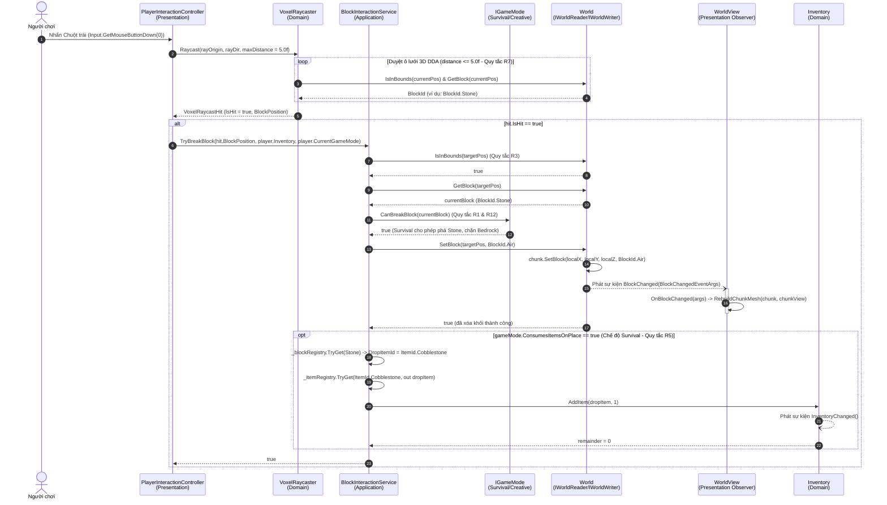
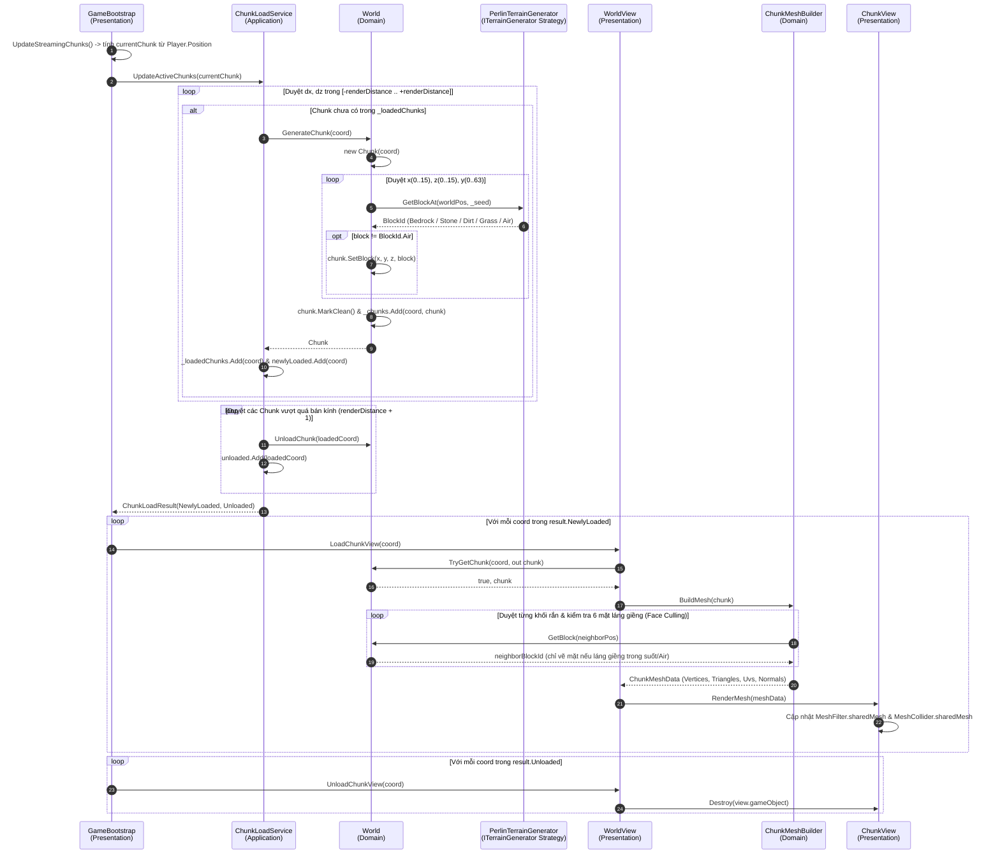
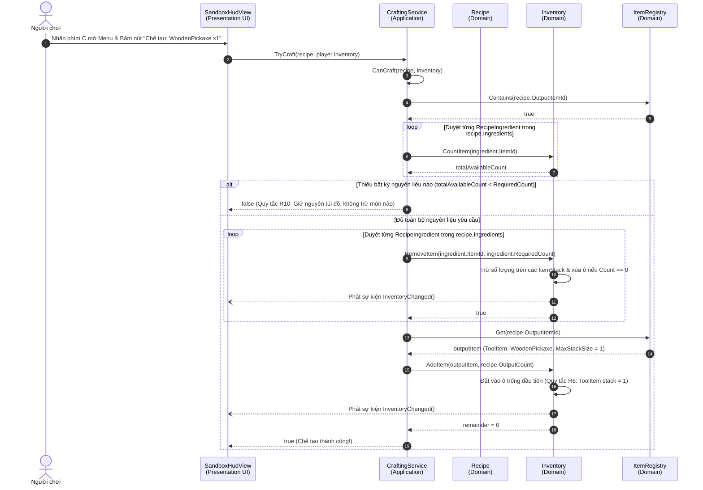
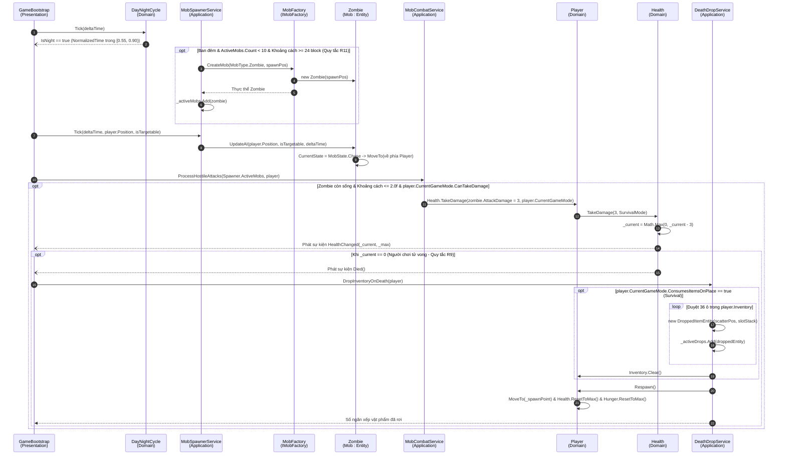

# Bộ 4 Sơ đồ Tuần tự (Sequence Diagrams) Đồng bộ 100% Thứ tự Gọi hàm Thực tế (Tiêu chí 7 — Barem [S2])

> Tài liệu này trình bày **4 Sơ đồ Tuần tự (Sequence Diagrams)** bằng Mermaid `sequenceDiagram`, chia đều **2 sơ đồ cho Thành viên A (Phân hệ World)** và **2 sơ đồ cho Thành viên B (Phân hệ Survival)**, bám sát 100% tên lớp, tên phương thức và thứ tự gọi hàm thực tế khi chương trình vận hành.

---

## Sơ đồ 1 (Thành viên A — Phân hệ World): Luồng Dò tia DDA & Phá Khối Rơi Vật phẩm (UC03 — Quy tắc R1, R3, R5, R7, R12)

**Kịch bản:** Người chơi nhấn chuột trái để đập vỡ một khối Đá (`BlockId.Stone`) trong tầm với $\le 5.0$ block. Hệ thống dò tia bằng thuật toán DDA (`VoxelRaycaster`), kiểm tra quyền phá khối của `IGameMode`, cập nhật dữ liệu `World`, kích hoạt sự kiện `BlockChanged` để `WorldView` dựng lại lưới Mesh của Chunk, đồng thời rơi vật phẩm `ItemId.Cobblestone` vào `Inventory` của người chơi.

---

## Sơ đồ 2 (Thành viên A — Phân hệ World): Luồng Di chuyển Sinh Chunk & Dựng Lưới Face Culling (UC02 — Strategy Pattern)

**Kịch bản:** Khi khởi động hoặc khi người chơi di chuyển sang một tọa độ Chunk mới, `GameBootstrap` gọi `ChunkLoadService.UpdateActiveChunks(centerChunk)`. Dịch vụ tự động sinh các Chunk mới trong bán kính tầm nhìn thông qua chiến lược `PerlinTerrainGenerator`, giải phóng các Chunk ở xa, sau đó `WorldView` sử dụng `ChunkMeshBuilder` để loại bỏ các mặt bị che khuất (Face Culling 6 hướng) và đẩy lưới vào `ChunkView`.

---

## Sơ đồ 3 (Thành viên B — Phân hệ Survival): Luồng Chế tạo Vật phẩm Atomic theo Quy tắc R10 (UC09)

**Kịch bản:** Người chơi nhấn phím `C` mở bảng Bàn Chế Tạo trên `SandboxHudView` và bấm nút chế tạo công thức **Cúp gỗ (`WoodenPickaxe`)** cần `3 Planks + 2 Wood`. `CraftingService` thực thi **Quy tắc R10 ("Đủ hết hoặc không làm gì" — Atomic Transaction)**: kiểm tra đủ tất cả nguyên liệu qua `CanCraft` trước khi trừ từng nguyên liệu và thêm thành phẩm vào `Inventory`.

---

## Sơ đồ 4 (Thành viên B — Phân hệ Survival): Luồng Sinh Quái Ban Đêm (R11), Chiến đấu, Chết Rơi Đồ & Hồi sinh (R9 — UC12)

**Kịch bản:** Khi `DayNightCycle` bước vào ban đêm (`IsNight == true`), `MobSpawnerService` kiểm tra điều kiện **Quy tắc R11** (ban đêm, số lượng $< 10$, khoảng cách tới người chơi $\ge 24$ block) và gọi `MobFactory.CreateMob` để sinh `Zombie`. Trong mỗi khung hình, `Zombie.Tick` cập nhật AI truy đuổi người chơi; khi tiếp cận trong bán kính tấn công, `MobCombatService` gây sát thương lên `Player.Health`. Khi máu giảm về `0`, sự kiện `Died` kích hoạt `DeathDropService.DropInventoryOnDeath` làm rơi toàn bộ đồ trong túi thành các `DroppedItemEntity` trên mặt đất và hồi sinh người chơi về `SpawnPoint` (**Quy tắc R9**).

