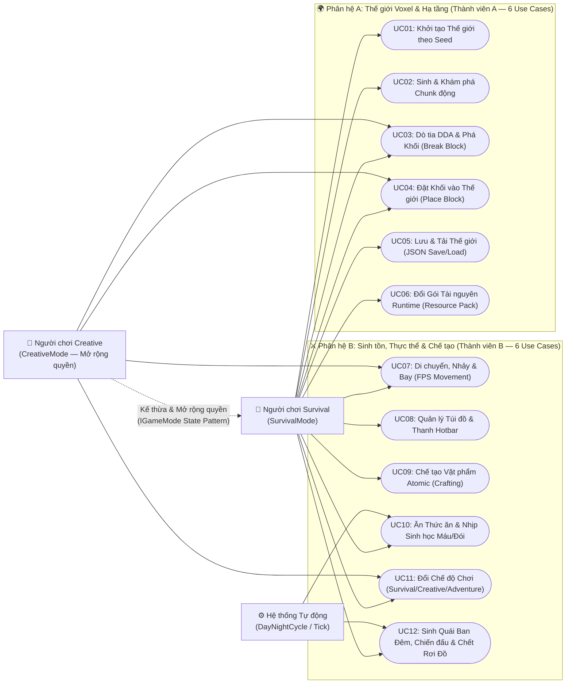

# Sơ đồ Use Case & Đặc tả Nghiệp vụ Chi tiết (Tiêu chí 1 & 4 — Barem [S2])

> Tài liệu này đồng bộ **100%** với mã nguồn thực tế của dự án **Minecraft Voxel Survival & Creative (Unity 6 C#)** phiên bản `v1.0.0`.
> Đáp ứng **Tiêu chí 1** ($\ge 8$ Use Case khớp hàm điều khiển trong code, chia đều 2 thành viên: **12 Use Case** gồm 6 UC cho Thành viên A và 6 UC cho Thành viên B) và **Tiêu chí 4** (Tách lớp giao diện / nghiệp vụ, phân quyền tác nhân thông qua `IGameMode`).

---

## 1. Sơ đồ Use Case Tổng thể (Mermaid Flowchart LR)

---

## 2. Cơ chế Phân quyền Tác nhân theo `IGameMode` (Đáp ứng Tiêu chí 4)

Thay vì viết các câu lệnh rẽ nhánh `if (mode == "Survival")` rải rác khắp tầng giao diện (Presentation), dự án áp dụng **State Pattern** thông qua giao diện [`IGameMode`](file:///Users/admin/Documents/CodeProJect/MINECRAFT/Game/Assets/_Project/Scripts/Domain/Contracts/IGameMode.cs) và 3 lớp trạng thái cụ thể trong `Minecraft.Domain.GameModes`:

| Quyền hạn / Hành vi (`IGameMode`) | Người chơi Survival (`SurvivalMode`) | Người chơi Creative (`CreativeMode`) | Người chơi Adventure (`AdventureMode` - Bài mở rộng) |Phương thức kiểm tra trong Code |
| :--- | :---: | :---: | :---: | :--- |
| **Tên chế độ (`ModeName`)** | `"Survival"` | `"Creative"` | `"Adventure"` | `IGameMode.ModeName` |
| **Bay tự do (`CanFly`)** | ❌ Không (chịu trọng lực) | ✅ Có (`Space` / `LeftShift`) | ❌ Không | `FirstPersonPlayerController.HandleMovement()` |
| **Phá hủy nhanh (`IsInstantBreak`)** | ❌ Không (theo độ cứng R4) | ✅ Có (phá tức thì R12) | ❌ Không | `BlockInteractionService.CalculateBreakDuration()` |
| **Nhận sát thương (`CanTakeDamage`)** | ✅ Có (đói R8, quái đánh R9) | ❌ Không (bất tử R12) | ✅ Có | `MobCombatService.ProcessHostileAttacks()`, `Player.Tick()` |
| **Tiêu hao vật phẩm (`ConsumesItemsOnPlace`)** | ✅ Có (trừ khối/thức ăn, chết rơi đồ) | ❌ Không (vô hạn khối, chết giữ đồ R12) | ✅ Có | `BlockInteractionService.TryPlaceBlock()`, `DeathDropService.DropInventoryOnDeath()` |
| **Quyền phá khối (`CanBreakBlock(id)`)** | ✅ Phá mọi khối **trừ Bedrock** (R1) | ✅ Phá được mọi khối **kể cả Bedrock** (R12) | ❌ **Cấm phá mọi khối** (`return false`) | `BlockInteractionService.TryBreakBlock()` |

---

## 3. Bảng Đặc tả Chi tiết 12 Use Case & Ánh xạ Hàm Điều khiển (Đáp ứng Tiêu chí 1)

### 3.1 Phân hệ A — Thế giới Voxel & Hạ tầng (Thành viên A phụ trách: UC01 → UC06)

| Mã UC | Tên Use Case | Tác nhân | Tiền điều kiện | Luồng sự kiện chính | Luồng ngoại lệ / Thay thế | Quy tắc nghiệp vụ | Lớp & Phương thức Điều khiển trong Code |
| :---: | :--- | :--- | :--- | :--- | :--- | :---: | :--- |
| **UC01** | **Khởi tạo Thế giới theo Seed** | Người chơi / Hệ thống | File `config.json` sẵn sàng (hoặc dùng fallback mặc định). | 1. `ConfigLoader.LoadConfig()` đọc `DefaultSeed` từ `StreamingAssets/config.json`. 2. `GameBootstrap` khởi tạo chiến lược `PerlinTerrainGenerator`. 3. Tạo thực thể `World(generator, seed)`. | Nếu thiếu file `config.json` hoặc lỗi cú pháp JSON, khối `try-catch` trong `ConfigLoader` tự động trả về `GameConfigDto.CreateDefault()`. | **R3** (Biên độ cao `0 <= Y < 64`) | [`ConfigLoader.LoadConfig`](file:///Users/admin/Documents/CodeProJect/MINECRAFT/Game/Assets/_Project/Scripts/Infrastructure/Config/ConfigLoader.cs), [`World..ctor`](file:///Users/admin/Documents/CodeProJect/MINECRAFT/Game/Assets/_Project/Scripts/Domain/World/World.cs), [`PerlinTerrainGenerator.GetBlockAt`](file:///Users/admin/Documents/CodeProJect/MINECRAFT/Game/Assets/_Project/Scripts/Domain/World/PerlinTerrainGenerator.cs) |
| **UC02** | **Sinh & Khám phá Chunk động** | Người chơi (khi di chuyển) | `World` và `ChunkLoadService` đã khởi tạo. | 1. Xác định `ChunkCoord` hiện tại từ tọa độ `Player.Position`. 2. `ChunkLoadService.UpdateActiveChunks(center)` quét bán kính `RenderDistanceInChunks`. 3. Sinh dữ liệu các Chunk mới bằng `World.GenerateChunk(coord)`. 4. `ChunkMeshBuilder.BuildMesh(chunk)` loại bỏ mặt khuất (Face Culling) và `WorldView.LoadChunkView` hiển thị lên Unity. | Các Chunk nằm ngoài bán kính `renderDistance + 1` được tự động gọi `World.UnloadChunk(coord)` và hủy `ChunkView` để giải phóng RAM. | **R3**, Face Culling 6 hướng | [`ChunkLoadService.UpdateActiveChunks`](file:///Users/admin/Documents/CodeProJect/MINECRAFT/Game/Assets/_Project/Scripts/Application/World/ChunkLoadService.cs), [`World.GenerateChunk`](file:///Users/admin/Documents/CodeProJect/MINECRAFT/Game/Assets/_Project/Scripts/Domain/World/World.cs), [`ChunkMeshBuilder.BuildMesh`](file:///Users/admin/Documents/CodeProJect/MINECRAFT/Game/Assets/_Project/Scripts/Domain/World/ChunkMeshBuilder.cs), [`WorldView.LoadChunkView`](file:///Users/admin/Documents/CodeProJect/MINECRAFT/Game/Assets/_Project/Scripts/Presentation/World/WorldView.cs) |
| **UC03** | **Dò tia DDA & Phá Khối** | Người chơi Survival / Creative | Người chơi còn sống, nhấn chuột trái vào khối trong tầm với. | 1. `VoxelRaycaster.Raycast(origin, dir, 5.0f)` tìm khối rắn đầu tiên. 2. `BlockInteractionService.TryBreakBlock()` kiểm tra biên `IsInBounds` và quyền `gameMode.CanBreakBlock(block)`. 3. Gọi `World.SetBlock(pos, BlockId.Air)` phát sự kiện `BlockChanged`. 4. `WorldView.OnBlockChanged` dựng lại Mesh. 5. Nếu ở Survival, tra `BlockType.DropItemId` và gọi `Inventory.AddItem()`. | - Tầm nhìn $> 5$ block: `Raycast` trả về `VoxelRaycastHit.Miss` (**R7**). - Đập `Bedrock` ở Survival hoặc đập khối ở Adventure: `CanBreakBlock` trả về `false` (**R1**). - Ở Creative: phá tức thì, không rơi đồ thừa vào túi (**R12**). | **R1, R3, R4, R5, R7, R12** | [`VoxelRaycaster.Raycast`](file:///Users/admin/Documents/CodeProJect/MINECRAFT/Game/Assets/_Project/Scripts/Domain/World/VoxelRaycaster.cs), [`BlockInteractionService.TryBreakBlock`](file:///Users/admin/Documents/CodeProJect/MINECRAFT/Game/Assets/_Project/Scripts/Application/World/BlockInteractionService.cs), [`BlockInteractionService.CalculateBreakDuration`](file:///Users/admin/Documents/CodeProJect/MINECRAFT/Game/Assets/_Project/Scripts/Application/World/BlockInteractionService.cs) |
| **UC04** | **Đặt Khối vào Thế giới** | Người chơi Survival / Creative | Người chơi đang cầm `BlockItem` trên tay và nhấn chuột phải vào bề mặt khối. | 1. Lấy tọa độ ô liền kề `hit.AdjacentPosition` từ `VoxelRaycaster`. 2. `BlockInteractionService.TryPlaceBlock()` kiểm tra ô mục tiêu là `BlockId.Air` và không trùng ô chân/đầu người chơi. 3. Gọi `World.SetBlock(targetPos, blockItem.PlacedBlockId)`. 4. Nếu `gameMode.ConsumesItemsOnPlace == true` (Survival), trừ 1 vật phẩm ở ô đang chọn. | - Ô đặt đã có khối khác hoặc trùng vị trí người chơi đứng: từ chối đặt (**R2**). - Tọa độ $Y < 0$ hoặc $Y \ge 64$: từ chối đặt (**R3**). - Ở Creative: đặt khối không bị trừ số lượng trong túi (**R12**). | **R2, R3, R7, R12** | [`BlockInteractionService.TryPlaceBlock`](file:///Users/admin/Documents/CodeProJect/MINECRAFT/Game/Assets/_Project/Scripts/Application/World/BlockInteractionService.cs), [`World.SetBlock`](file:///Users/admin/Documents/CodeProJect/MINECRAFT/Game/Assets/_Project/Scripts/Domain/World/World.cs) |
| **UC05** | **Lưu & Tải Thế giới (JSON Save/Load)** | Người chơi (Nhấn `F5` / `F9`) | Thế giới đang chạy. | 1. Khi nhấn `F5`: `WorldPersistenceService.SaveGame()` đóng gói `Seed`, `PlayerSaveDto` (vị trí, máu, đói, GameMode, 36 ô túi đồ) và danh sách `BlockChangeDto` vào `WorldSaveDto`, ủy quyền `JsonWorldRepository.Save()` ghi ra file JSON. 2. Khi nhấn `F9`: `WorldPersistenceService.LoadGame()` đọc `WorldSaveDto`, đặt lại các khối vào `World`, khôi phục máu/đói/túi đồ/vị trí và GameMode cho `Player`. | Nếu file save không tồn tại, bị khóa quyền ghi hoặc hỏng cấu trúc JSON, khối `try-catch` trong `JsonWorldRepository` bắt `IOException`/`JsonException` và trả về `false` an toàn mà không làm văng game (Tiêu chí 19). | **Tiêu chí 16 & 19** (Repository + `try-catch`) | [`WorldPersistenceService.SaveGame`](file:///Users/admin/Documents/CodeProJect/MINECRAFT/Game/Assets/_Project/Scripts/Application/World/WorldPersistenceService.cs), [`WorldPersistenceService.LoadGame`](file:///Users/admin/Documents/CodeProJect/MINECRAFT/Game/Assets/_Project/Scripts/Application/World/WorldPersistenceService.cs), [`JsonWorldRepository.Save`](file:///Users/admin/Documents/CodeProJect/MINECRAFT/Game/Assets/_Project/Scripts/Infrastructure/Persistence/JsonWorldRepository.cs), [`JsonWorldRepository.Load`](file:///Users/admin/Documents/CodeProJect/MINECRAFT/Game/Assets/_Project/Scripts/Infrastructure/Persistence/JsonWorldRepository.cs) |
| **UC06** | **Đổi Gói Tài nguyên Runtime** | Người chơi (Nhấn `F2`) | Thư mục `StreamingAssets/ResourcePacks` hoặc `BuiltInAtlasProvider` sẵn sàng. | 1. Người chơi nhấn `F2` chuyển đổi giữa `default` (16x) và `OptimumRealism_64x` (64x). 2. `ResourcePackService.SwitchPack(packId)` gọi `ITextureAtlasProvider.LoadPack(packId)`. 3. Phát sự kiện `ResourcePackChanged(manifest)`. 4. `ResourcePackView.OnResourcePackChanged` đọc mảng byte ảnh `.png`, tạo `Texture2D` với `FilterMode.Point` và cập nhật `Material` của `WorldView`. | Nếu thư mục gói tài nguyên bị xóa hoặc file `pack.mcmeta` lỗi JSON, `FolderResourcePackProvider` bọc `try-catch` tự động ủy quyền (fallback) về `BuiltInAtlasProvider` hoặc sinh vân cờ vua dự phòng. | **Strategy + Observer + Tiêu chí 19** | [`ResourcePackService.SwitchPack`](file:///Users/admin/Documents/CodeProJect/MINECRAFT/Game/Assets/_Project/Scripts/Application/World/ResourcePackService.cs), [`FolderResourcePackProvider.LoadPack`](file:///Users/admin/Documents/CodeProJect/MINECRAFT/Game/Assets/_Project/Scripts/Infrastructure/ResourcePacks/FolderResourcePackProvider.cs), [`ResourcePackView.OnResourcePackChanged`](file:///Users/admin/Documents/CodeProJect/MINECRAFT/Game/Assets/_Project/Scripts/Presentation/World/ResourcePackView.cs) |

---

### 3.2 Phân hệ B — Sinh tồn, Thực thể & Chế tạo (Thành viên B phụ trách: UC07 → UC12)

| Mã UC | Tên Use Case | Tác nhân | Tiền điều kiện | Luồng sự kiện chính | Luồng ngoại lệ / Thay thế | Quy tắc nghiệp vụ | Lớp & Phương thức Điều khiển trong Code |
| :---: | :--- | :--- | :--- | :--- | :--- | :---: | :--- |
| **UC07** | **Di chuyển, Nhảy & Bay (FPS Movement)** | Người chơi Survival / Creative | `FirstPersonPlayerController` và `Player` đã khởi tạo. | 1. Nhận tín hiệu `WASD` và góc xoay chuột `Mouse X/Y`. 2. Kiểm tra quyền `IGameMode.CanFly`. 3. Nếu ở Survival (`CanFly == false`), áp dụng gia tốc trọng lực `-9.81f` và nhảy khi nhấn `Space` trên mặt đất. 4. Đồng bộ tọa độ sang `Player.MoveTo(pos)` trong tầng Domain. | Khi người chơi ở chế độ Creative (`CanFly == true`), vô hiệu hóa trọng lực, cho phép bay lên bằng `Space` và hạ độ cao bằng `LeftShift` với tốc độ `_flySpeed` (**R12**). | **R12** (Phân quyền bay theo GameMode) | [`FirstPersonPlayerController.HandleMovement`](file:///Users/admin/Documents/CodeProJect/MINECRAFT/Game/Assets/_Project/Scripts/Presentation/Player/FirstPersonPlayerController.cs), [`Player.MoveTo`](file:///Users/admin/Documents/CodeProJect/MINECRAFT/Game/Assets/_Project/Scripts/Domain/Entities/Player.cs) |
| **UC08** | **Quản lý Túi đồ & Thanh Hotbar** | Người chơi | `Inventory` (36 ô, 9 ô Hotbar) đã khởi tạo. | 1. Người chơi bấm phím số `1..9` hoặc cuộn con lăn chuột để gọi `Inventory.SelectHotbarSlot(index)`. 2. Khi nhặt vật phẩm hoặc phá khối, `Inventory.AddItem(item, count)` ưu tiên cộng dồn vào các ngăn xếp (`ItemStack`) cùng loại chưa đầy trước khi sang ô trống mới. 3. Phát sự kiện `InventoryChanged` để `SandboxHudView` vẽ lại thanh Hotbar. | - Vật phẩm thông thường cộng dồn tối đa **64** cái/ô; công cụ (`ToolItem`) tối đa **1** cái/ô (**R6**). - Nếu cả 36 ô đều đầy, `AddItem` trả về số lượng vật phẩm còn dư chưa nhặt được. | **R6** (`MaxStackSize` 64 vs 1) | [`Inventory.AddItem`](file:///Users/admin/Documents/CodeProJect/MINECRAFT/Game/Assets/_Project/Scripts/Domain/Items/Inventory.cs), [`Inventory.RemoveItem`](file:///Users/admin/Documents/CodeProJect/MINECRAFT/Game/Assets/_Project/Scripts/Domain/Items/Inventory.cs), [`Inventory.SelectHotbarSlot`](file:///Users/admin/Documents/CodeProJect/MINECRAFT/Game/Assets/_Project/Scripts/Domain/Items/Inventory.cs), [`ItemStack.Add`](file:///Users/admin/Documents/CodeProJect/MINECRAFT/Game/Assets/_Project/Scripts/Domain/Items/ItemStack.cs) |
| **UC09** | **Chế tạo Vật phẩm Atomic (Crafting)** | Người chơi | Người chơi nhấn phím `C` hoặc `E` mở Bàn Chế Tạo trên HUD. | 1. `SandboxHudView` duyệt danh sách công thức trong `RecipeBook`. 2. Gọi `CraftingService.CanCraft(recipe, inventory)` kiểm tra từng `RecipeIngredient` qua `Inventory.CountItem()`. 3. Khi bấm nút chế tạo, `CraftingService.TryCraft()` trừ toàn bộ nguyên liệu bằng `Inventory.RemoveItem()`, lấy thành phẩm từ `ItemRegistry.Get()` và thêm vào túi qua `Inventory.AddItem()`. | Nếu thiếu bất kỳ nguyên liệu nào trong công thức, `CanCraft` trả về `false`, nút chế tạo bị khóa mờ và `TryCraft` cam kết không trừ bất kỳ nguyên liệu nào (**Quy tắc R10 — Giao dịch nguyên tử**). | **R6, R10** (Đủ hết hoặc không làm gì) | [`CraftingService.CanCraft`](file:///Users/admin/Documents/CodeProJect/MINECRAFT/Game/Assets/_Project/Scripts/Application/Survival/CraftingService.cs), [`CraftingService.TryCraft`](file:///Users/admin/Documents/CodeProJect/MINECRAFT/Game/Assets/_Project/Scripts/Application/Survival/CraftingService.cs), [`RecipeBook.CreateDefault`](file:///Users/admin/Documents/CodeProJect/MINECRAFT/Game/Assets/_Project/Scripts/Domain/Crafting/RecipeBook.cs) |
| **UC10** | **Ăn Thức ăn & Nhịp Sinh học Máu/Đói** | Người chơi & Hệ thống Tự động | Người chơi cầm `FoodItem` (như `Apple`) hoặc thời gian trôi qua. | 1. **Ăn thức ăn:** Nhấn chuột phải gọi `SurvivalService.TryEatSelectedFood(player)` -> tăng điểm no `Hunger.Eat()`, hồi máu `Health.Heal()` và trừ 1 thức ăn nếu ở Survival. 2. **Nhịp sinh học:** Mỗi khung hình `SurvivalService.TickPlayerSurvival()` gọi `Player.Tick(dt)` -> `Hunger.Tick(dt)` giảm độ đói định kỳ. | - Khi `Hunger.Current >= 18`: tự động hồi 1 HP mỗi chu kỳ (**R8**). - Khi `Hunger.Current == 0`: bị rút 1 HP mỗi chu kỳ đói lả (**R8**). - Ở Creative: không bị mất máu do đói và ăn không tốn thức ăn (**R12**). | **R8, R12** | [`SurvivalService.TryEatSelectedFood`](file:///Users/admin/Documents/CodeProJect/MINECRAFT/Game/Assets/_Project/Scripts/Application/Survival/SurvivalService.cs), [`Player.Tick`](file:///Users/admin/Documents/CodeProJect/MINECRAFT/Game/Assets/_Project/Scripts/Domain/Entities/Player.cs), [`Hunger.Tick`](file:///Users/admin/Documents/CodeProJect/MINECRAFT/Game/Assets/_Project/Scripts/Domain/Entities/Hunger.cs), [`Health.Heal`](file:///Users/admin/Documents/CodeProJect/MINECRAFT/Game/Assets/_Project/Scripts/Domain/Entities/Health.cs) |
| **UC11** | **Đổi Chế độ Chơi (GameMode Switch)** | Người chơi (Nhấn `F1`) | `Player` và `GameModeService` đang hoạt động. | 1. Người chơi nhấn phím `F1`. 2. `GameModeService` chuyển trạng thái của `Player` xoay vòng giữa `SurvivalMode` -> `CreativeMode` -> `AdventureMode` qua `Player.ChangeGameMode(newMode)`. 3. Toàn bộ quyền bay, sát thương, phá khối lập tức đổi hành vi theo đối tượng State mới. | Nếu truyền `null` vào `ChangeGameMode`, phương thức ném `ArgumentNullException` để bảo vệ bất biến đóng gói của thực thể `Player`. | **R1, R12**, State Pattern | [`GameModeService.SwitchToSurvival`](file:///Users/admin/Documents/CodeProJect/MINECRAFT/Game/Assets/_Project/Scripts/Application/Survival/GameModeService.cs), [`GameModeService.SwitchToCreative`](file:///Users/admin/Documents/CodeProJect/MINECRAFT/Game/Assets/_Project/Scripts/Application/Survival/GameModeService.cs), [`GameModeService.SwitchToAdventure`](file:///Users/admin/Documents/CodeProJect/MINECRAFT/Game/Assets/_Project/Scripts/Application/Survival/GameModeService.cs), [`Player.ChangeGameMode`](file:///Users/admin/Documents/CodeProJect/MINECRAFT/Game/Assets/_Project/Scripts/Domain/Entities/Player.cs) |
| **UC12** | **Sinh Quái Ban Đêm, Chiến đấu & Chết Rơi Đồ** | Hệ thống Tự động & Người chơi | Chu kỳ `DayNightCycle` đang chạy; `MobSpawnerService`, `MobCombatService`, `DeathDropService` hoạt động. | 1. Khi `DayNightCycle.IsNight == true`, `MobSpawnerService.TrySpawnNightMob()` kiểm tra số lượng quái $< 10$ và khoảng cách $\ge 24$ block (**R11**), gọi `IMobFactory.CreateMob(MobType.Zombie, pos)`. 2. `Zombie.UpdateAI()` truy đuổi người chơi; khi vào tầm đánh, `MobCombatService.ProcessHostileAttacks()` trừ máu `Player.Health.TakeDamage()`. 3. Khi `Health.Current == 0`, sự kiện `Died` kích hoạt `DeathDropService.DropInventoryOnDeath(player)` làm rơi toàn bộ túi đồ ra các `DroppedItemEntity` và gọi `Player.Respawn()` về `SpawnPoint` với đầy máu/đói (**R9**). | - Ban ngày (`IsNight == false`), khoảng cách $< 24$ block hoặc đã đủ 10 quái: từ chối spawn (**R11**). - Nếu người chơi ở Creative (`CanTakeDamage == false`): quái không gây sát thương và không làm rơi đồ (**R12**). - Khi người chơi đi lại gần vật phẩm rơi trong bán kính `2.0f`: `DeathDropService.CollectNearbyDrops()` tự động nhặt lại vào túi. | **R9, R11, R12** | [`MobSpawnerService.TrySpawnNightMob`](file:///Users/admin/Documents/CodeProJect/MINECRAFT/Game/Assets/_Project/Scripts/Application/Survival/MobSpawnerService.cs), [`MobFactory.CreateMob`](file:///Users/admin/Documents/CodeProJect/MINECRAFT/Game/Assets/_Project/Scripts/Domain/Entities/Mobs/MobFactory.cs), [`MobCombatService.ProcessHostileAttacks`](file:///Users/admin/Documents/CodeProJect/MINECRAFT/Game/Assets/_Project/Scripts/Application/Survival/MobCombatService.cs), [`DeathDropService.DropInventoryOnDeath`](file:///Users/admin/Documents/CodeProJect/MINECRAFT/Game/Assets/_Project/Scripts/Application/Survival/DeathDropService.cs), [`Player.Respawn`](file:///Users/admin/Documents/CodeProJect/MINECRAFT/Game/Assets/_Project/Scripts/Domain/Entities/Player.cs) |
